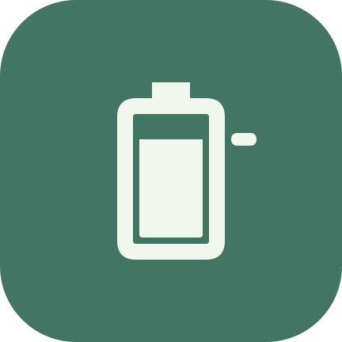
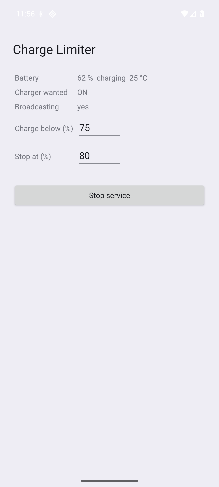
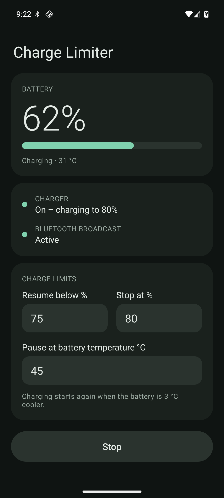
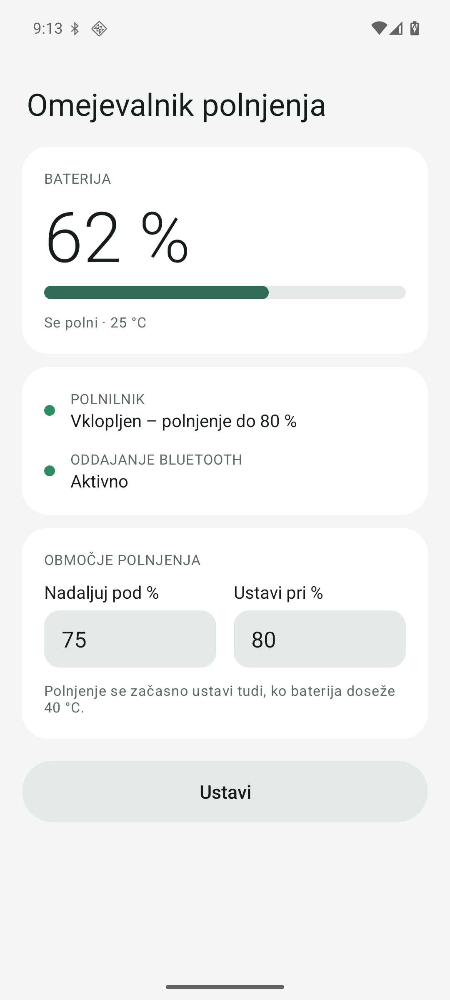

<p align="center">
  
</p>

<h1 align="center">Charge Limiter</h1>

<p align="center">
  Stop charging at 80% on phones that have no battery-protect option.
</p>

<p align="center">
  
  
  
</p>

Charge Limiter is an Android app plus a small script for a Shelly relay. The app
watches the phone's battery and broadcasts, over Bluetooth Low Energy, whether
the charger should be on. A Shelly 1 Gen4 wired in front of the charger listens
and switches the power.

Many phones cannot cap their own charge level, and a battery kept full and warm
ages fastest. This moves the cap outside the phone: the phone only says what it
wants, and the relay cuts the charger. Charging control never touches the cloud
or Wi-Fi, and the Shelly keeps its stock firmware.

> **Status:** the app runs on a real phone and broadcasts. The Shelly script
> passes its tests on a computer but has not yet been run on a Shelly.

## Highlights

- Stops at a level you choose (80% by default) and resumes just below it
- Pauses charging when the battery gets hot (45 °C by default, adjustable)
- One-way Bluetooth broadcast: no pairing, no connection to keep alive
- Fails safe: if the relay stops hearing the phone, the charger turns back on
- Survives screen-off, reboot (also before the first unlock) and app updates
- Stopping takes a two-second hold and a confirmation, so it can't happen by accident
- Updates itself from GitHub Releases
- English and Slovenian, light and dark theme
- No account and no app store

## Feature Overview

| Area | What you get |
|---|---|
| Charge range | "Resume below" and "Stop at" percentages, 75 / 80 by default |
| Heat guard | Pause at a battery temperature, resume 3 °C cooler |
| Status | Battery level, temperature, wanted charger state, broadcast state |
| Notification | Permanent status line while the service runs |
| Failsafe | Silence timeout in the script, plus a firmware timer on every "off" |
| Relay protection | At least 30 seconds between relay changes |
| Updates | Daily check, a notification when a release is out, one tap to install |

## Screens

<p>
  
  
  
</p>

## How It Works

1. A foreground service reads the battery level and temperature.
2. It decides whether the charger should be on and puts that in a BLE advert,
   about ten times a second.
3. The Shelly script scans for the advert and sets the relay to match.
4. If the script hears nothing for 120 seconds, it turns the relay on.
5. Every "off" command carries a 10-minute firmware timer that the script keeps
   renewing. If the script itself stops, the firmware turns the relay back on.

| Component | Runs on | Responsibility |
|---|---|---|
| `ChargePolicy` | phone | Level and heat decisions (pure, tested) |
| `ChargeService` | phone | Battery monitoring and the BLE broadcast |
| `charge-limiter.js` | Shelly | Validates adverts, drives the relay, failsafes |

The advert is 8 bytes of manufacturer data: a 4-byte token, a version, the
battery percentage, two flags and a counter. The script identifies the phone by
the token, never by its Bluetooth address, because Android rotates that address.

## Requirements

- An Android 8.0 or later phone that supports BLE advertising
- A Shelly 1 Gen4 on stock firmware with Bluetooth enabled
- The charger's power wired through the Shelly's relay

> **Mains voltage.** The Shelly 1 has a dry-contact relay that you wire into the
> charger's supply. If you are not qualified to do that, have an electrician do it.

## Install

Check [Releases](../../releases) for `charge-limiter-<version>.apk` and
`charge-limiter.js`.

### Phone

1. Copy the APK to the phone and open it. Allow installs from that source.
2. Open Charge Limiter and tap **Start**.
3. Allow Nearby devices (Bluetooth) and Notifications.
4. Accept the battery-optimisation exemption.

Some phones stop background apps regardless. On Xiaomi, POCO, Huawei, Oppo and
OnePlus, also enable **Autostart** for the app and set its battery saver to
**No restrictions**.

### Shelly

1. Open the Shelly's web page and enable Bluetooth.
2. Under **Scripts**, create a script and paste in `charge-limiter.js`.
3. Enable **Run on startup**, then start the script.
4. Set the switch's power-on default to **On**.

## Updates

The app checks this repository's releases once a day and when you open it. When
a newer version exists it shows a notification and an **Update to …** button.
The update is downloaded from GitHub and handed to Android's installer, which
only accepts it if it carries the same signing key as the installed app.

The first update asks you to allow the app to install apps, and Android asks
you to confirm the install. Later updates may install without a question,
depending on the Android version. This is the only thing the app uses the
internet for. Test builds (versions ending in `-dev`) do not update themselves.

## Settings

| Setting | Default | Range |
|---|---|---|
| Resume below | 75% | 0 to below "Stop at" |
| Stop at | 80% | up to 100 |
| Pause at battery temperature | 45 °C | 30 to 60 °C |

A narrow range near the limit is deliberate. With a wide one such as 20–80, a
phone that reached 80% and is plugged in again at 45% would not charge until it
fell to 20%.

Script timings live in the `CONFIG` block at the top of `charge-limiter.js`.

## Known Limitations

- **Unsigned broadcast.** Anyone in Bluetooth range who copies the advert can
  toggle the charger. Nothing else is exposed.
- **One shared token.** The token is fixed in the source, so every copy of a
  release uses the same one. Two people running this within Bluetooth range of
  each other would drive each other's relay. To make a set your own, change the
  token in `AdvertPayload.kt` and in the script's `CONFIG`, and build it yourself.
- **Heat guard needs the charger behind the relay.** It cannot slow charging,
  only cut it.
- **Not yet proven on a Shelly.** See the status note at the top.

## Development

Toolchains are pinned with [mise](https://mise.jdx.dev):

```bash
mise install
./gradlew assembleDebug testDebugUnitTest lintDebug
node --test shelly/test/*.test.js
```

Install on a connected phone:

```bash
adb install -r app/build/outputs/apk/debug/app-debug.apk
```

The design and plan are in `docs/superpowers/`, and measured facts from real
devices in `docs/findings.md`.

## Publishing a Release

Push a tag that starts with `v`:

```bash
git tag v0.1.0
git push origin v0.1.0
```

The Release workflow tests, builds the APK, and publishes a GitHub Release with
the APK and the Shelly script. To sign with a stable key, set the repository
secrets `KEYSTORE_BASE64`, `KEYSTORE_PASSWORD`, `KEY_ALIAS` and `KEY_PASSWORD`.
Without them the APK gets a temporary debug signature, and Android will refuse
to install a later release over it.

## Uninstall

Uninstall the app from the phone. On the Shelly, stop and delete the script; the
relay then stays in whatever state you set by hand.
